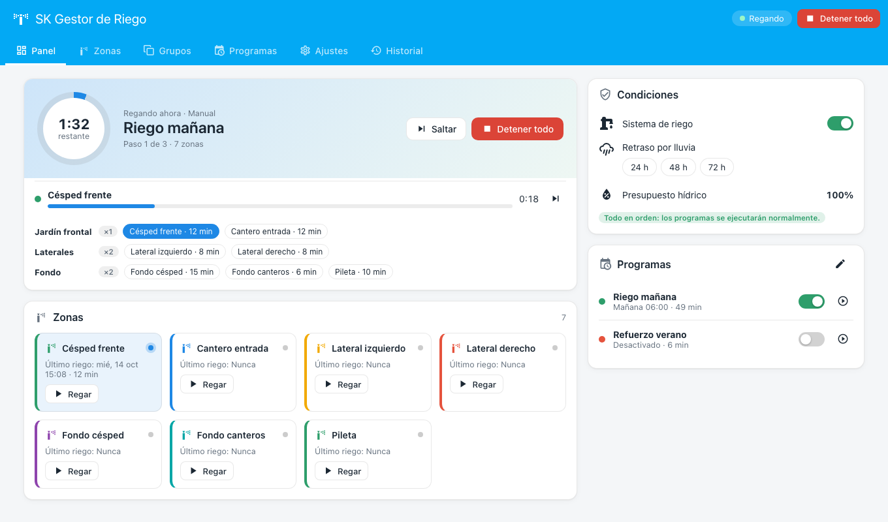
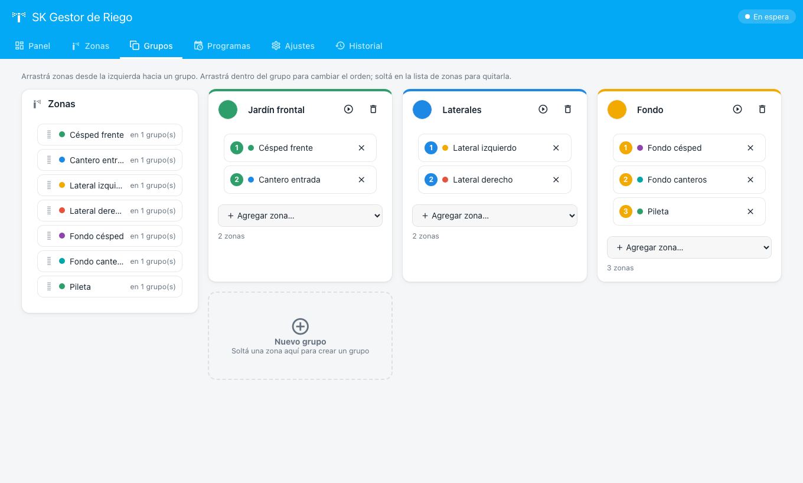
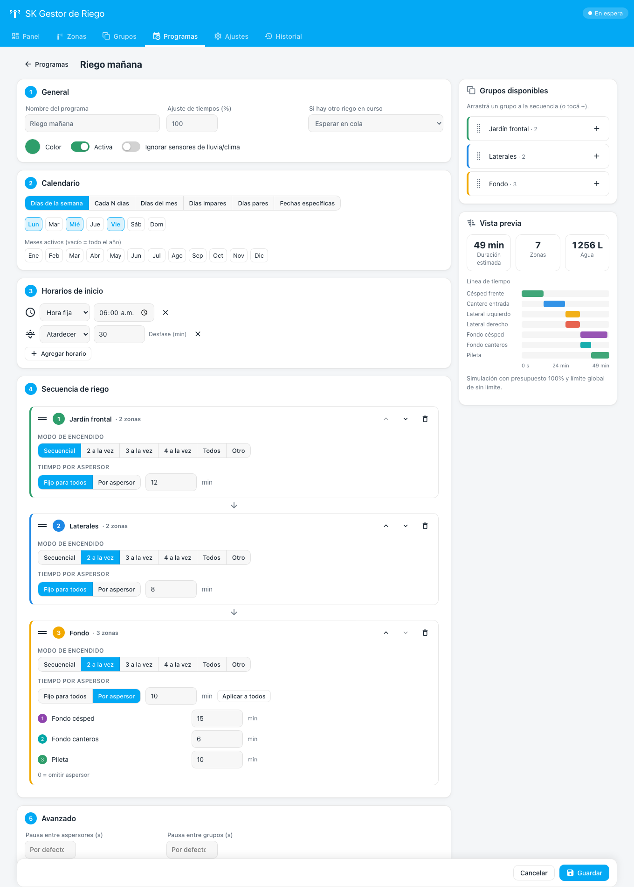
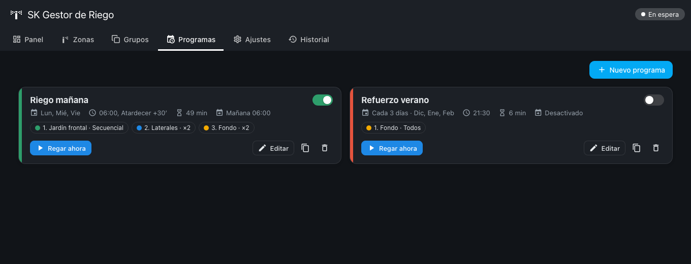

# SK Irrigation Manager for Home Assistant

[](https://hacs.xyz/docs/faq/custom_repositories)
[](https://github.com/SkynetCom/sk-irrigation-manager-ha/actions/workflows/validate.yml)


Gestor de riego profesional para Home Assistant con **panel propio**, **grupos drag & drop**, **secuencias con encendido simultáneo configurable** y **múltiples programas por día**. Funciona con **Rain Bird** (con soporte nativo de duración) y con cualquier aspersor/válvula expuesto como `switch`, `valve`, `input_boolean`, `light` o `fan` (OpenSprinkler, Sonoff, Shelly, ESPHome, Zigbee, Z-Wave, relés, etc.).

> 🇬🇧 English summary at the [bottom](#english).



| Grupos drag & drop | Editor de programas con vista previa |
|---|---|
|  |  |



---

## ¿Por qué otro módulo de riego?

| | Irrigation Unlimited | Smart Irrigation | Rain Bird (core) | OpenSprinkler | **SK Irrigation Manager** |
|---|---|---|---|---|---|
| Configuración | YAML extenso | UI (solo cálculo) | Integración de dispositivo | Depende del controlador | **Panel visual completo** |
| Grupos de aspersores | Sí (YAML) | No | No | Estaciones | **Drag & drop** |
| Encendido simultáneo N a la vez | Parcial | No | No | Limitado | **1 / 2 / 3 / 4 / todos / N por paso** |
| Tiempo fijo o por aspersor | YAML | Calcula duración | Fijo | Sí | **Ambos, por paso** |
| Varios horarios por día | Sí | No aplica | No | Sí | **Ilimitados (fijo, amanecer, atardecer)** |
| Días/mes/año, pares/impares, fechas | Sí (YAML) | No | No | Parcial | **Sí, + meses activos (temporadas)** |
| Vista previa / línea de tiempo | No | No | No | No | **Gantt en el editor** |
| Lluvia / clima / helada | Plantillas | ET | No | Sensor | **Sensores + clima + temperatura + retraso** |
| Presupuesto hídrico | Manual | Sí | No | Sí | **Global, por programa y por sensor (compatible con Smart Irrigation)** |
| Válvula maestra / bomba | Sí | No | No | Sí | **Sí, con adelanto/retardo** |
| Rain Bird: duración real | — | — | Duración por defecto fija | — | **Usa `rainbird.start_irrigation` con la duración exacta** |

Ideas tomadas de cada uno: la potencia de secuencias de *Irrigation Unlimited*, el presupuesto de *Smart Irrigation* (podés conectar su sensor de % directamente) y la simplicidad de los controladores comerciales — pero todo editable desde una UI.

## Características

- **Panel lateral** propio, responsive (escritorio, tablet y móvil), modo claro/oscuro según tu tema, en **español e inglés**.
- **Zonas**: detecta automáticamente switches/válvulas; botón *Agregar todas las zonas Rain Bird*; color, caudal (L/min), habilitar/deshabilitar y prueba de 1 minuto.
- **Grupos con drag & drop** (mouse y táctil): arrastrá zonas a grupos, reordená dentro del grupo, soltá en la lista para quitar, soltá en "Nuevo grupo" para crear uno. Una zona puede estar en varios grupos.
- **Programas**:
  - Calendario: días de la semana, cada N días, días del mes, impares, pares o fechas específicas (con repetición anual), filtrado por **meses activos**.
  - **Múltiples horarios por día**: hora fija, amanecer o atardecer con desfase.
  - **Secuencia** armada arrastrando grupos; cada paso define:
    - **Modo de encendido**: secuencial, 2, 3, 4, todos o cualquier N a la vez (cola rodante: cuando termina un aspersor arranca el siguiente, sin esperar al lote completo).
    - **Tiempo**: fijo para todos los aspersores del grupo o **personalizado por aspersor** (0 = omitir).
  - Ajuste de tiempos (%), pausa entre aspersores y entre grupos, qué hacer si hay otro riego en curso (encolar u omitir), ignorar sensores.
  - **Vista previa** con duración estimada, consumo de agua y **línea de tiempo (Gantt)**.
- **Panel en vivo**: progreso general, aspersores activos con cuenta regresiva, saltar zona, detener todo, cola de ejecución y riego manual de zonas o grupos.
- **Condiciones**: sensores de lluvia, entidad de clima (condiciones configurables), temperatura de helada, retraso por lluvia (24/48/72 h), presupuesto global o por sensor.
- **Hidráulica**: válvula maestra o bomba con adelanto/retardo y **límite global de zonas simultáneas** (protege la presión del sistema).
- **Seguridad**: si HA se reinicia durante un riego, al volver cierra todas las válvulas; si alguien apaga una zona manualmente, la secuencia continúa con la siguiente; tiempo máximo por zona.
- **Historial** con duración y litros estimados, notificaciones opcionales y **exportar/importar** la configuración en JSON.

## Instalación

### HACS (recomendado)
1. HACS → ⋮ → **Repositorios personalizados** → URL `https://github.com/SkynetCom/sk-irrigation-manager-ha`, tipo **Integration**.
2. Buscá **SK Irrigation Manager** e instalalo.
3. Reiniciá Home Assistant.
4. **Ajustes → Dispositivos y servicios → Agregar integración → SK Irrigation Manager**.
5. Aparece **Riego** en la barra lateral.

### Manual
Copiá `custom_components/sk_irrigation` en `config/custom_components/` y reiniciá.

## Uso rápido
1. **Zonas** → *Agregar todas las zonas Rain Bird* (o agregá switches/válvulas uno a uno).
2. **Grupos** → arrastrá las zonas a grupos (ej. *Frente*, *Laterales*, *Fondo*).
3. **Programas** → *Nuevo programa* → elegí días y horarios → arrastrá grupos a la secuencia → definí cuántos aspersores a la vez y los tiempos → **Guardar**.

## Entidades y servicios

| Entidad | Descripción |
|---|---|
| `switch.sk_irrigation_manager_sistema_de_riego` | Habilita/deshabilita todos los programas |
| `switch.sk_irrigation_manager_programa_<nombre>` | Un switch por programa |
| `sensor.sk_irrigation_manager_estado` | `idle`, `running`, `paused`, `rain_delay`, `disabled` (+ atributos: programa, zonas activas, cola, motivos) |
| `sensor.sk_irrigation_manager_proximo_riego` | Fecha/hora del próximo riego |
| `sensor.sk_irrigation_manager_tiempo_restante` | Minutos restantes del riego actual |
| `sensor.sk_irrigation_manager_zonas_activas` | Cantidad de zonas regando |

Servicios: `sk_irrigation.run_program`, `run_group`, `run_zone`, `stop_all`, `skip`, `set_rain_delay`.

```yaml
# Ejemplo: regar el frente 8 minutos, de a 2 aspersores
action: sk_irrigation.run_group
data:
  group: "Jardín frontal"
  duration: 8
  concurrency: 2
```

## Notas sobre Rain Bird
La integración oficial de Rain Bird abre la zona con una duración por defecto (configurable en sus opciones). SK Irrigation Manager detecta las entidades de la plataforma `rainbird` y usa `rainbird.start_irrigation` con la duración exacta de cada paso, y las apaga al finalizar o al saltar. Si el controlador limita la cantidad de zonas simultáneas, configurá el **máximo de zonas simultáneas** en Ajustes.

## Desarrollo
- `dev/demo.html` es una demo del panel con un backend simulado (no requiere HA): `python3 -m http.server 8765` y abrí `http://localhost:8765/dev/demo.html`.
- Tests: `pytest tests` (la lógica de calendario/planificación no depende de HA; los tests de integración usan `pytest-homeassistant-custom-component`).

## Licencia
MIT © SK / SkynetCom

---

## English

**SK Irrigation Manager** is a Home Assistant integration with its own sidebar panel to manage irrigation professionally:
drag & drop zone groups, programs with multiple start times per day (fixed, sunrise, sunset), weekday / every-N-days / month-day / odd / even / specific-date calendars with active months, per-step activation (sequential, 2, 3, 4, all or N sprinklers at once using a rolling queue), fixed or per-sprinkler durations, a Gantt preview, live dashboard, rain/weather/freeze skip conditions, water budget (global, per program or from a sensor such as Smart Irrigation), master valve/pump, global concurrency limit, history, notifications and JSON backup.
Works with Rain Bird (exact durations through `rainbird.start_irrigation`) and any `switch`, `valve`, `input_boolean`, `light` or `fan` entity.
Install through HACS as a custom repository (`https://github.com/SkynetCom/sk-irrigation-manager-ha`, category *Integration*), restart, then add the **SK Irrigation Manager** integration.
